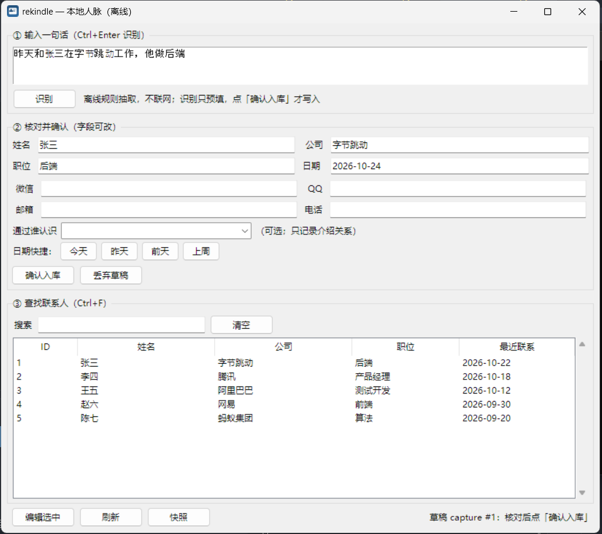
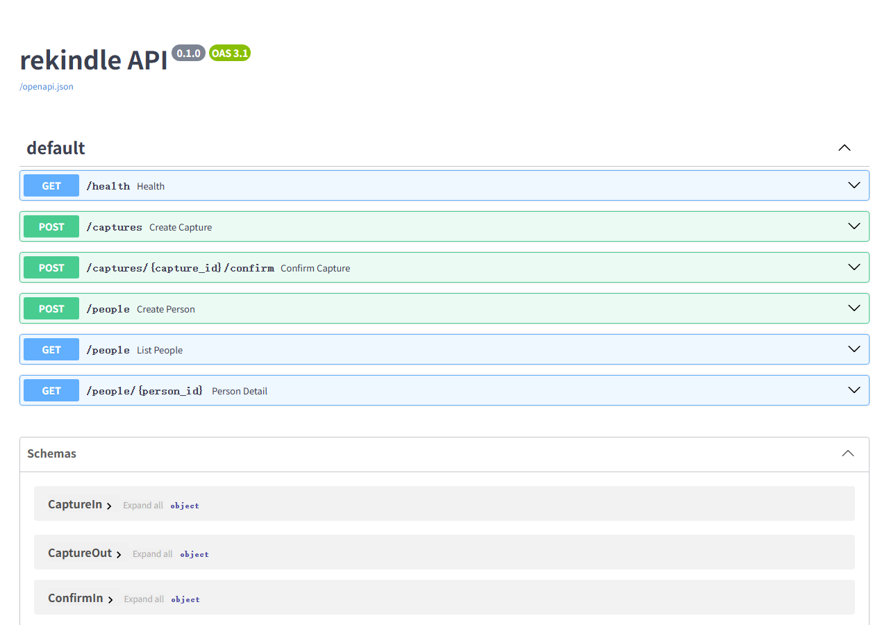

# rekindle

[](https://github.com/R36a/rekindle/actions/workflows/ci.yml)

> 本地优先的个人人脉管理器：**一句话记人，随时找得到**。

- **完全离线**：运行时本应用不产生网络请求，防止个人隐私泄露
- **快**：一句话 3 步入库；列表最近联系优先，搜索即时过滤
- **越用越准**：姓名优先级 = 已有人脉姓名 > 常见大姓 > 常见小姓；抽不到就留空让你改
- **不自动写入**：抽取结果先预填，你确认后才入库
- **公司按时间积累**：同一个人换公司不会覆盖旧记录，详情里能看到完整公司历史
- **联系方式可多个**：微信 / QQ / 邮箱 / 电话都支持追加（不覆盖旧值），搜索时也会匹配
- **可以不写句子**：留空原话、直接填姓名等字段入库；记录文本自动生成「用户输入了：姓名：…」
- **可修改**：详情页可改资料、公司历史、联系方式、交往记录；删除用归档；保存前自动快照
- **可回退**：GUI 里能查看快照列表并一键恢复；恢复前自动再备份当前数据
- **可记关系**：详情页能记「他认识谁」，新增联系人可记「通过谁认识」；关系类型六档（陌生人 → 亲戚）

<p align="center">
  
</p>
<p align="center"><sub>一句话识别 → 字段预填 → 确认入库；列表按最近联系排序（截图为演示数据）</sub></p>

## 状态

**离线原型**（首个公开版本 `v0.1.0`）：记一句话 → 规则抽取 → 人工确认 → 入库 → 搜索查看。

- **只有两件事**：快速记人、快速查人。提醒与待办已按产品决策移除（没人会在电脑上维护它们）；
- **LLM 未接入（不是“默认关闭”，是没有入口）**：`domain/extract_llm.py`、`infra/llm_http.py` 与 6 个单测保留，但 CLI / GUI / API 都不会调用它们，运行时零出站；
- 尚未实现：设置持久化、消歧打分、全局热键（见 [TODO.md](TODO.md)）。

产品边界、数据模型、里程碑见：

- [开发文档 v0.2](docs/开发文档.md) —— 定位、原则、边界、架构、里程碑
- [设计细节 v0.2](docs/设计细节.md) —— 数据模型、抽取管线、消歧、提醒、隐私

## 快速上手（Windows）

1. 从 [Releases](https://github.com/R36a/rekindle/releases/latest) 下载 **`rekindle-v0.1.0-win64.exe`**（约 20 MB，无需安装 Python）
2. 双击即可，无需安装 Python。首次启动约 5–20 秒（单文件解压 + 杀软扫描），之后 2 秒内；exe 未签名，SmartScreen 提示时点「更多信息 → 仍要运行」
3. 三步：**① 输入一句话 → 识别 → ② 核对并确认 → ③ 搜索联系人**

数据默认存在 `%USERPROFILE%\.rekindle\rekindle.db`；换位置用 `--db` 或环境变量 `REKINDLE_DB`。

重新打包：`pip install -e ".[build]"`，然后 `.\tools\build_exe.ps1`（产物在 `dist\`）。

## 从源码运行（开发）

需要 **Python 3.14+**（与 `pyproject.toml` 的 `requires-python` 一致；CI 也只测这个版本）。

```bash
python -m venv .venv
.venv\Scripts\activate          # Windows
pip install -e ".[dev,llm,api]"
pytest                          # 144 个测试，全离线

# 1. 记一句话：只存草稿（capture），不入库
python -m rekindle remember "上周和张三在字节工作，他做后端"

# 2. 确认入库：可覆盖抽错的字段
python -m rekindle confirm 1
python -m rekindle confirm 2 --name 李四 --company 腾讯 --when 2026-10-20
python -m rekindle confirm 3 --when 昨天        # --when 支持 今天/昨天/前天/上周
python -m rekindle confirm 4 --name 王五 --wechat wangwu_wx --email w@example.com
python -m rekindle add --name 赵六 --wechat zhaoliu_wx   # 不写句子，直接入库
python -m rekindle archive 1                        # 归档（不删数据）
python -m rekindle snapshot                         # 立即备份数据库
python -m rekindle snapshots                        # 列出快照
python -m rekindle restore <快照文件>                 # 恢复（先自动备份当前数据）

# 3. 查找（最近联系优先；姓名/公司/职位/别名都能搜）
python -m rekindle list
python -m rekindle list -q 字节
python -m rekindle show 1
python -m rekindle alias 1 张总

# 4. 备份 / 恢复（JSON 是权威格式）
python -m rekindle export backup.json
python -m rekindle import backup.json --db new.db

python -m rekindle --help          # 全部命令
```

数据默认存 `~/.rekindle/rekindle.db`，可用全局参数 `--db` 或环境变量 `REKINDLE_DB` 指定。

**一次记录的状态流转**：`capture(draft)` → 用户 `confirm` → `capture(confirmed)` + `person` + `interaction`。
未确认的草稿不产生任何交往记录；同一条 capture 因数据库唯一约束只能入库一次。

## 图形界面

```powershell
.venv\Scripts\python.exe -m rekindle.interfaces.gui     # 源码方式
.venv\Scripts\rekindle-gui.exe               # 安装后（不弹控制台）
```

界面从上到下：

1. **输入一句话**：输入原文，点「识别」或按 `Ctrl+Enter`（离线规则抽取；**识别只预填，不会入库**）；
2. **核对并确认**：姓名 / 公司 / 职位 / 日期都能手动改；日期默认今天，旁边有【今天/昨天/前天/上周】快捷按钮；
3. **查找联系人**：搜索框输入姓名/公司/职位/别名即时过滤（`Ctrl+F` 定位，`Esc` 清空）；双击联系人看交往记录。
4. **关系**：详情页「人脉关系」可记录他认识谁；新增联系人时可选「通过谁认识」（只记介绍关系，不自动补认识边）。

GUI 用 Python 内置 Tkinter，不额外安装（PySide6-Essentials 下载失败时的降级方案，见 ADR-007）。


## HTTP API（可选）

CLI / GUI / HTTP 共用同一套 `app/` 用例层，换入口不改业务逻辑。

```bash
pip install -e ".[api]"
rekindle-api --db ~/.rekindle/rekindle.db --port 8000
# 交互式文档：http://127.0.0.1:8000/docs
```

| 方法 | 路径 | 说明 |
|---|---|---|
| GET | `/health` | 健康检查 |
| POST | `/captures` | 记一句话（只存草稿） |
| POST | `/captures/{id}/confirm` | 确认草稿并入库 |
| POST | `/people` | 不写句子，直接按字段入库 |
| GET | `/people?query=&limit=` | 列表（最近联系优先） |
| GET | `/people/{id}` | 详情 + 交往记录 |

业务错误映射：找不到 404、重复确认 409、字段不合法 400。

<p align="center">
  
</p>

## 隐私

本工具不连接任何自有服务器，当前版本也**不接入任何大模型**：没有设置项、没有开关，运行时不会产生网络请求。

仓库里保留了 LLM 抽取的代码与测试（`domain/extract_llm.py`、`infra/llm_http.py`），但没有任何入口调用它们。将来若要接入，原则是：
原文只会发送到**你自己配置的端点**，发送前展示目标域名与将发送的文本，并记录本地调用日志。

## License

MIT，见 [LICENSE](LICENSE)。
